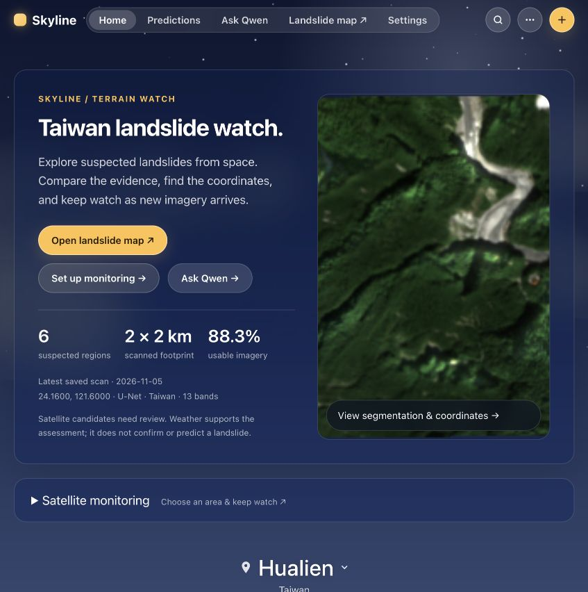

# Skyline / TerrainWatch

**Taiwan landslide review, weather and air quality — Veritas AI Hackathon 2026, Climate track.**

The final tested hackathon app is in **[submission/](submission/)**. It includes the trained multispectral U-Net checkpoint, Sentinel-2 scan pipeline, local Qwen assistant, new glass Skyline interface, automatic monitoring controls, evaluation evidence and submission documents.



## Run the final version

```bash
cd submission
python3 -m venv .venv
source .venv/bin/activate
python -m pip install -r requirements.txt
python check_setup.py --inference
python run.py
```

Open http://127.0.0.1:8765/skyline/ for the home workspace. Tested on macOS Apple Silicon with Python 3.14.4. See the [complete setup, optional Qwen configuration and limitations](submission/README.md).

## Submission documents

- [One-page write-up](submission/one-page-writeup.pdf)
- [Demo script and recording instructions](submission/two-minute-demo-script.txt)
- [Model results and limitations](submission/MODEL_CARD.md)
- [Data, model and AI-tool credits](submission/CREDITS.md)
- [Final readiness audit](submission/evidence/final-readiness.json)
- [Submission checklist and judge access](submission/GITHUB_SUBMISSION.md)
- [Validation evidence](submission/evidence/)

The retained U-Net achieved 54.27% pixel IoU and 70.36% Dice on a small, repeatedly consulted development holdout. Live Taiwan accuracy remains unmeasured. Detected regions are **suspected landslides**, not confirmed hazards or validated predictions of slope failure.

The original teammate source remains in `ui/`. The integrated release uses its tested bundled Skyline snapshot in `submission/skyline/`. The integrated frontend includes the teammate’s ui-glass update while keeping landslide review as the focus. Demo scans and simulated-weather controls are excluded.

Before submitting, ensure judges can access the repository; this branch upload does not change its visibility.
