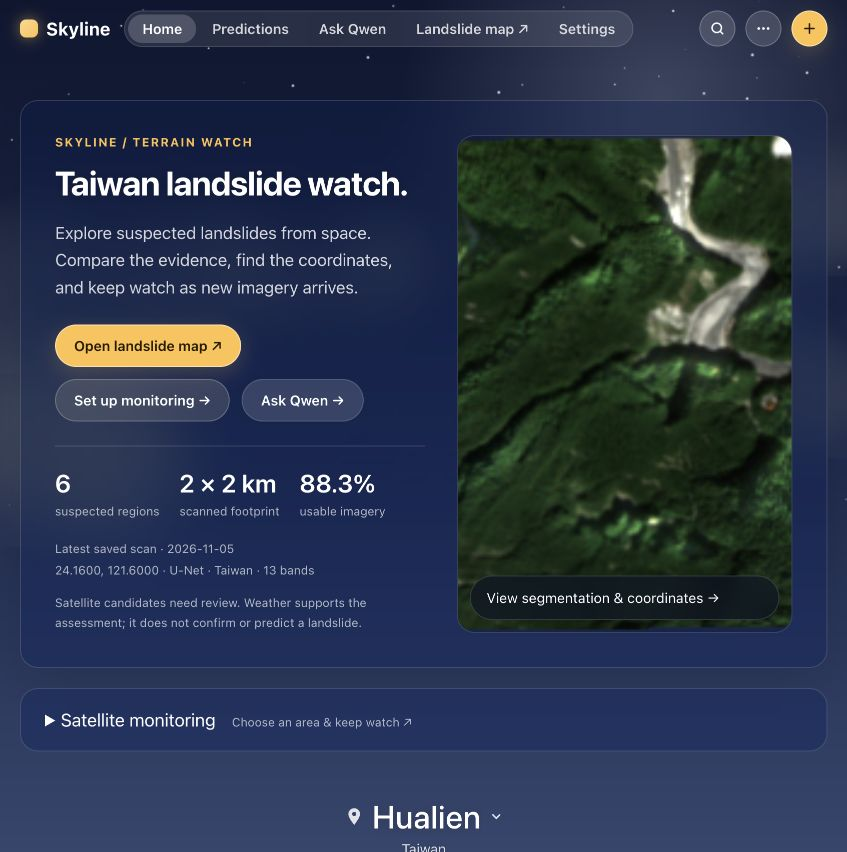

# Skyline / Terrain Watch

**A Taiwan landslide review workspace built for the Veritas AI International High School Hackathon 2026 · Climate track.**

Terrain Watch uses a trained multispectral U-Net to outline suspected landslides in free Sentinel-2 imagery. It puts the candidates, coordinates, before/after vegetation, terrain slope, nearby roads and weather in one review workflow. Local Qwen can propose a scan and answer follow-up questions. Skyline adds city weather and trained PM2.5 forecasts.

**These are suspected satellite observations, not confirmed landslides or predictions of slope failure.**



## Run it

The final release includes the retained U-Net checkpoint. No account or paid API key is needed for manual scans. Internet access is needed to install dependencies and retrieve live satellite, terrain, weather and road data. Qwen is optional.

Tested with **Python 3.14.4 on macOS Apple Silicon** in a newly created virtual environment. Other operating systems are not yet verified; use the supplied tested environment rather than assuming all binary wheels exist for an older Python.

```bash
python3 -m venv .venv
source .venv/bin/activate
python -m pip install -r requirements.txt
python check_setup.py --inference
python run.py
```

Open **http://127.0.0.1:8765/skyline/** for the home workspace or **http://127.0.0.1:8765/** for the map. On Windows, environment activation is `.venv\Scripts\activate`; Windows has not been tested. `python run.py --port 8766` selects another port. Keep the server local; this prototype is not configured for an unauthenticated public deployment.

### Real scans only

The app does not include demo scans, an offline demo mode or a simulated-weather selector. Choose an area, find satellite scenes and run a scan. Completed scans appear in local history with their acquisition dates; reviewing history does not rerun inference. A fresh installation starts with no scan results. Missing live data is shown as unavailable.

### Optional local Qwen

Install [Ollama](https://ollama.com/) and select a model installed on your computer. The development Mac uses a local alias named `qwen3.5:9b-mlx`; that alias is **not distributed** with this repository. A publicly available alternative is [Qwen3 8B](https://ollama.com/library/qwen3:8b):

```bash
ollama pull qwen3:8b
export TERRAIN_QWEN_MODEL='qwen3:8b'
python run.py
```

Keep Ollama running. The configurable endpoint defaults to `http://127.0.0.1:11434`; override with `TERRAIN_OLLAMA_URL` if needed. The public alternative was verified as available, but response quality and performance are not claimed identical to the local demo model. Missing Qwen is reported clearly; manual scans and exports still work.

### Automatic monitoring

Monitoring is **off by default**. Select a footprint, preview its boundary and press Start hourly monitoring. The server checks for newly published Sentinel-2 scenes hourly and scans new scenes. New acquisitions are normally days apart, not hourly. The Mac must remain awake with the server running. Pause stops future checks; an active scan finishes. Seen scenes are preserved across pause/resume. Weather and clouds can leave areas unassessed.

## How the AI works

1. Retrieve and stitch Sentinel-2 L2A tiles covering the selected footprint.
2. Align 11 reflectance bands, Copernicus DEM and slope to the analysis grid.
3. Apply the trained **ResNet34 U-Net, 13 inputs, 128 × 128 native windows**, stride 96, frozen normalization and threshold **0.024**. Coarse bands are resampled; this does not create finer native detail.
4. Exclude cloud, shadow, water and missing inputs; convert predicted pixels to georeferenced polygons.
5. Attach vegetation comparison, road distance and forecast context **after segmentation**. Common review questions use measured answers labelled “Measured scan evidence”; Qwen handles broader follow-ups using structured context. Neither provides a validated landslide probability.

Coordinates are points inside polygons derived from imagery, not surveyed locations. Road proximity does not prove blockage. Terrain is both a model input and a supporting check, so that check is not independent validation.

## Results and limitations

| Evaluation | Result | Scope |
| --- | --- | --- |
| Frozen 13-channel transfer baseline | 43.15% pixel IoU; 60.29% Dice | Same inventory holdout and local normalization |
| Retained Taiwan fine-tuned U-Net | **54.27% IoU; 70.36% Dice** | 24 patches from 3 regions; repeatedly compared during development |
| Retained U-Net precision / recall | 62.13% / 81.09% | Inventory-labelled valid pixels only |
| Live Taroko pipeline check | 6 × 6 km; 58 seconds; 76 candidates | 90.8% usable imagery; no field confirmation |
| Live Taichung pipeline check | 6 × 6 km; 130 seconds; 148 candidates | 2 stitched tiles; 76.9% usable imagery |
| Taichung PM2.5 model | **4.379 µg/m³ MAE**, versus 5.906 persistence | 25.9% lower error; 365 test days, 2025-11-08 through 2026-11-07 |

The landslide holdout is small, geographically limited and positive-enriched. Boundaries, uncertain inventory negatives and prior benchmark exposure limit interpretation. Live-image accuracy remains unmeasured. See [evaluation evidence](evidence/) and [the model card](MODEL_CARD.md), including an error-example figure. PM2.5 targets are CAMS estimates rather than station measurements; historical error does not establish future sensor-level accuracy.

## Verify the release

```bash
python check_setup.py --inference
python -m pip install -r requirements-dev.txt
python -m pytest test_*.py -q
node --test test_location.cjs test_review_filters.cjs test_scan_display.cjs test_review_links.cjs
(cd skyline/ui/app && python -m pytest test_server.py test_predict.py -q)
(cd skyline/ui/server && python -m pytest test_skyline_extras.py -q)
```

The setup check opens both apps, all 22 city reports, verifies model SHA-256 and runs the real U-Net on a bundled satellite patch. It does not request live imagery or enable monitoring. See `evidence/final-readiness.json` and `evidence/validation.txt` for the latest release checks. Optional MCP and scikit-learn parity checks are skipped when those development dependencies are absent; neither is required to run the integrated app. `requirements-tested-macos-arm64.txt` records the complete installed environment; it includes test dependencies.

## Contribution and credits

Our team trained/adapted the segmentation model and built the Taiwan scan, evidence-review, monitoring and Qwen workflow. Our teammate built Skyline's weather interface and air-quality component during this hackathon; we integrated them into one local application. Existing pretrained architectures, external data and AI coding assistance are credited rather than claimed as inventions.

- [One-page write-up](one-page-writeup.pdf)
- [Two-minute script and recording instructions](two-minute-demo-script.txt)
- [Datasets, models, libraries and AI tools](CREDITS.md)
- [Historical training source and scope](docs/training-source/README.md)
- [GitHub upload instructions](GITHUB_SUBMISSION.md)

No emergency-service deployment, prevented disaster or measured time saving for field teams is claimed. The intended next step is independent annotation of recent Taiwan scenes and evaluation with landslide/road reviewers.

### Hourly monitoring reports

Choose an area and start monitoring. The server saves a report immediately and every hour while enabled, even when no new scene arrives or a scan is still running. Open **Hourly reports** on the map to read/download the latest 24 snapshots; up to 168 are retained locally. Reports include the watched coordinates, catalogue status and latest completed scan with review locations. Saved scan/weather timestamps are preserved; reports do not turn old imagery into new observations or refresh saved forecasts. Qwen can answer “show the latest hourly report.” The Mac must stay awake with the server running; missed hours are not backfilled. Runtime reports are excluded from the submission package.

### Whole-Taiwan imagery watch

On the map open **Whole-Taiwan watch → Preview coverage → Start whole-Taiwan monitoring**. This mode is paused by default. It partitions mapped land into 433 planning cells (Taiwan main island, Penghu, Kinmen, Matsu and mapped smaller islands inside the supported map bounds). Each cell uses a 12 km native-resolution U-Net scan square. It checks the paginated Sentinel-2 catalogue every 15 minutes, queues new acquisition/source-update fingerprints, scans serially, and resumes its queue after a restart. Initially it uses the newest available pass per cell in a rolling 14-day catalogue window; outages longer than that are not backfilled automatically. Cloud failures remain unassessed.

Based on recent local timings, initial coverage is estimated at **29–79 hours**, not a promise or a benchmark of a completed national run. The preview recalculates this estimate. This cannot complete before the current hackathon deadline. Hundreds of scans can require tens of GB; the queue pauses below 10 GiB free without deleting existing results.

Rainfall forecasts (24/48 hours and peak hour), wind and temperature come from MET Norway/ECMWF. Weather context is recomputed hourly with the provider-aware cache; forecast issue/window timestamps are preserved. Rain watch appears even in cells not yet scanned. Candidate review ranking combines forecast rain, vegetation/slope support and road proximity. The 80 mm/24 h or 20 mm/hour thresholds are experimental review rules, not official warnings. Wind/temperature are context only. Antecedent observed rain, soil moisture, validated landslide probabilities and confirmed severity are not implemented.

The coverage grid exposes queued, scanning, failed/unassessed and partial/completed cells. Regional usable percentages refer to each scan square, not a national clear-land fraction. Up to 20 candidates per cell are retained for the national ranking; the map lists the top 50, with links to actual saved polygons. All detections remain in each scan. Candidate ownership by representative point prevents duplicate counts across overlapping scan squares; it does not merge separate pieces of a landslide split across cell borders.

National summaries are saved hourly while enabled (last 168 retained), with a download link. Ask Qwen about “whole Taiwan monitoring.” The Mac must remain awake and the server running. State and reports are runtime-only and are excluded from the submission. A complete nationwide live pass has **not** been run.
