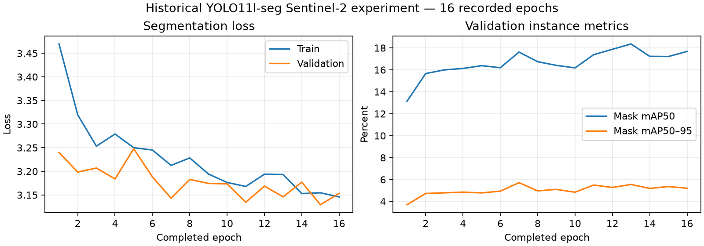

# Historical Ultralytics YOLO experiments

Supporting experiment evidence for Skyline / TerrainWatch. **The submitted map uses the retained 13-input U-Net**, documented in [the model card](../../MODEL_CARD.md). These are earlier YOLO experiments, not results of the deployed U-Net. No training was rerun to prepare this evidence.

## Training runs

The first three runs used LMHLD's Taiwan RGB subset: 5,270 train, 1,506 validation and 753 test patches, using the supplied splits. Native patches are 224 × 224; the 448 runs upsample them. The fourth run fine-tuned the large RGB model on Landslide4Sense: 3,799 prepared train, 245 validation and 800 test patches. Native patches are 128 × 128, RGB B4/B3/B2, per-channel 2nd–98th percentile stretch to uint8, resized to 448 for YOLO. This does not add spatial detail. Geographic independence cannot be verified from the patch files.

Each row below is the **highest validation mask mAP50–95 epoch in that run's CSV**, not an untouched test result or necessarily the checkpoint selected by Ultralytics' combined fitness. The 16-epoch Sentinel-2 run was stopped before its configured 30 epochs; the pinned checkpoint used for the final threshold sweep is recorded as epoch 7.

| Run / raw training history | Recorded epochs | Peak mask-mAP epoch (CSV) | Mask mAP50 | Mask mAP50–95 |
| --- | ---: | ---: | ---: | ---: |
| [yolo11n-seg-224](yolo11n-seg-224/results.csv) | 50 | 49 | 46.95% | 20.57% |
| [yolo11n-seg-448](yolo11n-seg-448/results.csv) | 50 | 49 | 52.50% | 25.69% |
| [yolo11l-seg-448](yolo11l-seg-448/results.csv) | 50 | 41 | 52.36% | 25.86% |
| [yolo11l-seg-sentinel2-448](yolo11l-seg-sentinel2-448/results.csv) | 16 | 7 | 17.62% | 5.72% |

Ultralytics training validation calculates instance precision/recall and mAP; `conf: null` in the training arguments uses the validator's default behavior. These are not pixel IoU, pixel accuracy or calibrated hazard probabilities. Saved configurations are in each run's `args.yaml`. Original training plots, mask precision–recall curves and normalized confusion matrices are included where available; the interrupted Sentinel-2 run has a chart regenerated directly from its CSV.

## Sentinel-2 confidence selection and pixel evaluation

The final CPU sweep tested 123 confidence settings on **validation only**, maximizing global union-mask pixel IoU. It verified the three finalists with direct inference and selected **0.09**, with input 448, NMS IoU 0.7 and maximum 1,000 detections. Checkpoint SHA-256: `40bb73fd45f984c290b3d8c387e79018185995d896cbccbdd5733387a8ed6a24`.

| Split | Images | Pixel IoU | Dice | Pixel precision | Pixel recall |
| --- | ---: | ---: | ---: | ---: | ---: |
| Validation (used to choose threshold) | 245 | 37.03% | 54.05% | 56.47% | 51.83% |
| Test (evaluated at fixed 0.09) | 800 | 38.27% | 55.36% | 51.79% | 59.45% |

Sources: [threshold sweep](sentinel2-threshold-sweep/results.json), [validation counts and per-image results](sentinel2-threshold-sweep/selected-threshold-validation.json), [test counts and per-image results](sentinel2-threshold-sweep/selected-threshold-test.json). Historical fields such as `applied_to_map` describe that earlier experiment; they do not describe the current U-Net deployment.

## Why we moved to U-Net

The workflow needed dense pixel masks and access to infrared bands and terrain, beyond the three RGB inputs used in these YOLO experiments. The retained U-Net uses 11 satellite bands plus slope and elevation. Its Taiwan-inventory evaluation is a **different dataset and split** from Landslide4Sense and LMHLD. Do not compare its 54.27% IoU against these YOLO figures as a controlled improvement, and do not compare instance mAP with pixel IoU. No new head-to-head evaluation on the final Taiwan holdout is supplied here. Cloud/vegetation/road checks remain context, not field confirmation.

## Reproducibility and credits

- [Dataset metadata and conversion checks](datasets/) preserve source, preprocessing and split counts. Label-conversion fidelity values measure raster-to-polygon reconstruction, **not model accuracy**.
- [Artifact provenance](artifact-provenance.json) records source and packaged hashes. Only local path prefixes were removed from JSON/YAML; numeric results were preserved.
- Configured source model/data paths are historical references, not files bundled in this evidence directory. Large YOLO checkpoints, datasets and caches are excluded.
- [Project credits](../../CREDITS.md) link Ultralytics YOLO11, LMHLD and Landslide4Sense and describe pretrained/data usage. The final U-Net model remains the submission's primary result.
